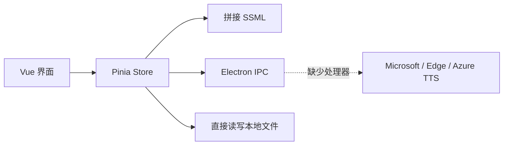

# TTS Free 项目代码体检与优化计划

## 总体结论

当前项目不是简单的局部优化阶段，而是需要先恢复功能闭环，再进行架构升级。

现有代码更接近一个尚未完成的 Electron TTS 原型：界面、状态和调用意图基本存在，但关键的 TTS 主进程实现缺失，部分界面功能仍是占位状态。

## 当前实现概况

主要技术栈：

- Vue 3 + TypeScript + Pinia
- Electron
- Element Plus
- 预设 Microsoft Speech、Edge Speech、Azure Speech 三种接口
- 支持普通文本、SSML、批量 TXT、音色/风格/角色、试听和导出等设计目标

当前调用关系：



## 必须优先解决的问题

### 1. 核心 TTS 功能没有实现闭环

渲染层在 `src/store/play.ts` 中调用以下 IPC：

- `speech`
- `edgeApi`
- `azureApi`

但 `electron/main/index.ts` 中没有对应的 `ipcMain.handle()` 实现。窗口最小化、最大化、关闭等 IPC 处理器也处于注释状态。

因此，当前代码无法真正完成语音转换。

### 2. Electron 安全模型风险较高

主窗口当前使用：

```ts
nodeIntegration: true
contextIsolation: false
```

因此 Vue 渲染页面可以直接使用 `fs`、`shell`、`ipcRenderer` 和 `electron-store`。如果页面或依赖被注入，攻击代码可能直接获得本地 Node.js 权限。

建议调整为：

- `nodeIntegration: false`
- `contextIsolation: true`
- 在 preload 中使用 `contextBridge`
- 仅暴露经过白名单约束的 TTS、文件和窗口 API
- 在主进程中再次校验文件路径和 IPC 参数

### 3. Pinia Store 职责过多

`src/store/firstStore.ts` 同时负责：

- 页面状态
- 配置持久化
- SSML 生成
- 网络重试
- 文本切片
- 音频合并
- 批量任务调度
- 文件读写
- 用户通知

这会导致核心逻辑难以测试，也容易出现状态相互影响的问题。

### 4. 批量转换存在异步控制问题

批处理使用了 `forEach(async () => {})`，会产生以下问题：

- `start()` 不会等待全部文件完成
- 多个文件会无限制并发
- `isLoading` 可能被任意任务提前设置为 `false`
- 成功和失败状态不准确
- 无法可靠地暂停、取消或重试任务

建议改成明确的任务队列，并限制同时处理的文件数，例如并发 2～3 个任务。

### 5. SSML 生成重复且缺少转义

SSML 在多个文件中重复拼接，用户输入未进行 XML 转义。输入包含 `&`、`<`、`>` 时可能导致 SSML 无效。

建议建立唯一的 `buildSsml()` 模块，统一完成：

- 文本 XML 转义
- 音色、风格和角色参数校验
- 普通文本与原始 SSML 模式区分
- SSML 单元测试

### 6. 已发现的功能与质量问题

- 配置中的 `retryInterval` 没有传给 TTS 调用，用户设置不会生效。
- 默认配置在每次启动时都会被覆盖。
- 语言中文名称被错误设置为 `ZH_CN` 一类的键，而不是对应中文名称。
- `src/global/voices.ts` 约 932 KB、接近两万行，直接进入前端包。
- 创建的音频 Blob URL 没有调用 `URL.revokeObjectURL()`，长期运行可能积累内存。
- 多段 MP3 直接通过 `Buffer.concat()` 合并，可能造成头信息、播放间隙或兼容性问题。
- 设置页仍是占位页面。
- 下载按钮没有绑定实际下载动作，音频播放器也没有完整接入状态。
- 使用了 `@element-plus/icons-vue`，但没有在 `package.json` 中直接声明依赖。
- 项目没有依赖锁文件、测试、Lint、格式化和完整 CI 基线。
- Electron Builder 中仍使用 `YourAppID` 和 `YourAppName` 占位配置。
- 当前仓库没有安装 `node_modules`，构建检查会停止在 `vue-tsc: command not found`。

## 推荐实施计划

### 第一阶段：恢复可运行基线

优先级最高。

1. 补齐依赖并生成锁文件。
2. 分离 `typecheck`、`build:renderer`、`build:electron` 和 `package` 脚本。
3. 确定并实现可用的 TTS Provider。
4. 补齐窗口、文件、日志和 TTS IPC。
5. 修复转换按钮、播放、下载和保存路径功能。
6. 修复默认配置、重试间隔和语言名称等明显问题。
7. 完成一次单文本端到端转换验证。

完成标准：应用能够正常启动、转换、试听和保存，并能清楚展示错误信息。

### 第二阶段：重构核心架构

建议目录结构：

```text
src/
  stores/
    editor.ts
    settings.ts
    tasks.ts
  services/
    tts-client.ts
    ssml.ts
    text-splitter.ts
    audio.ts
  types/
    tts.ts
electron/
  main/
    ipc/
    services/
      providers/
        edge.ts
        azure.ts
    storage/
  preload/
    index.ts
```

统一 Provider 接口：

```ts
interface TtsProvider {
  getVoices(): Promise<Voice[]>;
  synthesize(request: TtsRequest): Promise<Uint8Array>;
  validateConfig(): Promise<void>;
}
```

这样新增或替换合法 TTS 服务时，不需要同时改动 UI 和 Store。

### 第三阶段：完善批量任务

- 根据标点智能切片，优先保持句子完整
- 使用有限并发任务队列
- 单任务重试和指数退避
- 显示进度、耗时和失败原因
- 支持暂停、取消和重新执行失败项
- 处理输出文件重名
- 支持输出目录选择
- 使用可靠的音频合并策略

### 第四阶段：优化产品体验

- 音色搜索以及语言、性别、风格筛选
- 收藏和最近使用音色
- 实时字数与预计分段数
- 转换历史记录
- SSML 编辑器校验
- 深色模式与响应式布局
- 常用快捷键
- 设置导入和导出
- 密钥隐藏与安全存储
- 清楚区分免费、非官方和 Azure 付费接口

### 第五阶段：质量与发布

- 使用 Vitest 测试 SSML、文本切片、配置迁移和任务队列
- 增加 Electron IPC 集成测试
- 增加 Playwright 冒烟测试
- 配置 ESLint 和 Prettier
- 配置 GitHub Actions 多平台构建
- 设置正确的应用 ID、名称、图标、版本和发布说明
- 补充接口来源、使用限制和隐私说明

## 推荐执行顺序

1. 恢复 TTS 功能闭环
2. 收紧 Electron 安全边界
3. 拆分 Store 和 TTS Provider
4. 修复并增强批量任务
5. 重做设置页与主界面
6. 添加测试和发布流程

## 后续推进方式

每个阶段都应先建立可验证的完成标准，再实施代码修改。建议第一轮开发只聚焦“安全且可运行的单文本转换闭环”，避免同时重做全部界面和批量功能。
